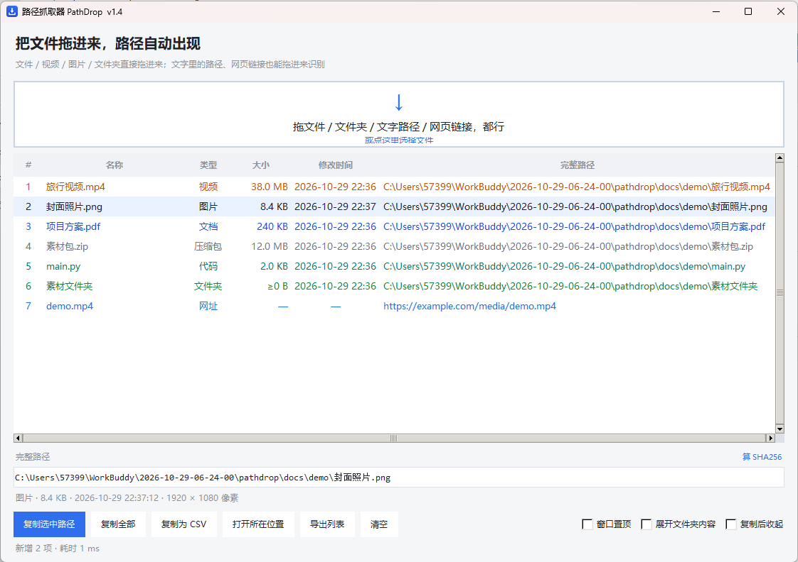

# PathDrop

**Drag anything in — get the full path instantly.**

**English** | [简体中文](#简体中文)

[](https://github.com/sajiangsika-collab/pathdrop/releases)
[](LICENSE)
[](https://www.python.org/)
[](https://github.com/sajiangsika-collab/pathdrop/actions/workflows/build.yml)



Copying a file path on Windows normally means holding Shift, right-clicking, and picking
"Copy as path" — or fishing the string out of the address bar by hand. Long paths and
non-ASCII folder names make it worse. PathDrop turns that into a single drag: drop it in,
see the full path, click once and it's on your clipboard.

It also understands **plain text** (a path buried in a chat message or a Word document)
and **web links** (it will even find the matching local file in your Downloads folder).

## Features

- **Every file type**: files, videos, images, audio, documents, archives, executables, source code, folders — classified and color-coded by extension
- **Drop text, too**: drag a snippet from a chat window, Notepad or Word; PathDrop extracts the path inside (quotes, `《》`, `file:///` URIs, `%USERPROFILE%`, forward slashes, POSIX paths)
- **Drop links, too**: URLs are listed as *Link* entries, and PathDrop looks for a file with the same name in `Downloads` / `Desktop` and tells you where it landed
- **Useful details**: name, type, size, modified time, full path; image resolution for pictures, duration for videos (requires `ffprobe`)
- **Handy actions**: sort by any column, copy selected / all / CSV, copy SHA256, reveal in file manager, export CSV / TXT
- **Stays out of the way**: always-on-top toggle, auto-hide after copying (or press `Esc`), double-click the icon again to bring the same window back instead of opening a second one
- **No installation**: a single executable, no registry writes, settings stored in your user config folder

## Download

Grab the package for your OS from [Releases](https://github.com/sajiangsika-collab/pathdrop/releases):

| Platform | File | Notes |
| --- | --- | --- |
| Windows 10/11 (x64) | `PathDrop-1.4-windows-x64.zip` | Unzip and run `PathDrop.exe`, no installer |
| macOS (Intel / Apple Silicon) | `PathDrop-1.4-macos.zip` | Unzip to get `PathDrop.app`; unsigned, so right-click → Open the first time |
| Linux (x64) | `PathDrop-1.4-linux-x64.tar.gz` | `chmod +x PathDrop && ./PathDrop`; needs X11 |

> All three packages are built natively on each OS by GitHub Actions — see [build.yml](.github/workflows/build.yml).
> The binaries are not code-signed, so Windows SmartScreen / macOS Gatekeeper may warn about an
> "unknown developer". That is expected.

## Usage

1. Launch the app
2. Drag files / folders from your file manager into the window (anywhere in the window works)
3. Select the row you need → click **Copy selected**, or just press `Ctrl+C`

| Action | What it does |
| --- | --- |
| Double-click a row | Open with the default app (links open in your browser) |
| Right-click | Copy path / copy filename / copy SHA256 / open in browser / reveal / remove |
| `Ctrl+C` | Copy selected paths (copies everything when nothing is selected) |
| `Ctrl+A` | Select all |
| `Ctrl+V` | Add paths / links from the clipboard |
| `Esc` | Hide the window; double-click the icon again to bring it back |
| Click a column header | Sort by that column, click again to reverse |
| `Delete` | Remove selected rows from the list |

Three toggles in the bottom-right corner: **Always on top**, **Expand folders** (also list
everything inside a dropped folder), **Hide after copy**.

## What it understands

| Dropped content | Result |
| --- | --- |
| `C:\Users\me\Desktop\report.docx` | Recognized as-is |
| `"C:\...\meeting notes.docx"` | Quotes stripped |
| `《C:\...\meeting notes.docx》` | Chinese title marks stripped |
| `file:///C:/Users/me/report.docx` | Converted to a local path, `%20` decoded |
| `I saved it to C:\...\report.docx already` | Extracted from the sentence |
| `C:/Users/me/Desktop` (forward slashes) | Normalized |
| `%USERPROFILE%\Desktop` | Environment variables expanded |
| `/Users/me/Desktop/a.txt`, `~/a.txt` | POSIX paths (macOS / Linux) |
| `https://example.com/a.mp4`, `www.bilibili.com/video/BV1xx` | Listed as a link, matching local file looked up |
| `let's meet at three` | Ignored — just a status message |

## Run from source

```bash
# Linux: install tkinter first
sudo apt install python3-tk        # Debian/Ubuntu
# sudo dnf install python3-tkinter # Fedora

pip install -r requirements.txt
python pathdrop.py
```

## Build it yourself

```bash
pip install -r requirements.txt pyinstaller pillow
python build.py --package
```

Output: `dist/PathDrop.exe` (Windows), `dist/PathDrop.app` (macOS), `dist/PathDrop` (Linux);
adding `--package` also creates the archive under `release/`.

> PyInstaller cannot cross-compile — macOS and Linux packages must be built on those systems.
> The GitHub Actions matrix in this repo already does that: push a `v*` tag and it builds and
> publishes to Releases automatically.

## Project layout

```
pathdrop.py     main program (single file, ~1100 lines, tkinter + tkinterdnd2)
build.py        unified build script for all three platforms
make_icon.py    generates app.ico / app.png / docs/icon-512.png
requirements.txt
快速上手.txt     quick-start note shipped inside the release archive
docs/           screenshots and icons
.github/workflows/build.yml   three-platform CI build + release
```

## Privacy

- Fully local: no network access, no file contents ever uploaded
- Dropped URLs are parsed as strings and matched against local folders only — **no HTTP requests**
- Settings live in `%APPDATA%\PathDrop\setting.json` (macOS: `~/Library/Application Support/PathDrop/`, Linux: `~/.config/pathdrop/`)

## Known limitations

- Read-only: it displays and copies paths, never modifies or moves files
- Folder sizes are estimates (first 4000 entries), shown with a `≥` prefix
- Video duration requires `ffprobe` on your machine; without it you only get the basic info
- The "reveal in file manager" action uses Explorer on Windows, Finder on macOS and the default file manager on Linux

## Changelog

- **1.4** Cross-platform (macOS / Linux build and run); fonts and icons picked per OS
- **1.3** Web links supported as *Link* entries, with local same-name file lookup
- **1.2** Text drops supported: paths inside sentences, `file:///` URIs, environment variables
- **1.1** Column sorting, detail panel (resolution / duration), SHA256, hide after copy, single-instance restore
- **1.0** Initial release: drag files to see paths, classification, copy, export

## License

[MIT](LICENSE) © 2026 sajiangsika-collab

---

# 简体中文

[English](#pathdrop) | **简体中文**

**把文件、文件夹、文字里的路径、网页链接拖进窗口，立刻显示完整路径，一键复制。**

平时要复制某个文件的路径，得在资源管理器里按住 Shift 右键、或者手动往地址栏里抠，
遇到长路径和中文目录更麻烦。这个小工具把这件事变成「拖一下就完事」：
拖进来就直接看到完整路径，点一下就进剪贴板。

除了文件本身，它还能听懂**一段文字**（聊天记录、文档里夹着的路径）和**网页链接**
（并去你的下载目录里找同名文件）。

## 功能

- **任意格式**：文件、视频、图片、音频、文档、压缩包、程序、代码、文件夹都认，按扩展名自动归类上色
- **拖文字也认**：从聊天窗口、记事本、Word 里拖一段带路径的文字进来，自动把路径抠出来（支持引号、书名号、`file:///`、`%USERPROFILE%`、正斜杠、POSIX 路径等写法）
- **拖链接也认**：网页链接作为「网址」列出，并自动去 `下载` / `桌面` 里找同名本地文件，告诉你它落在哪个路径
- **信息够用**：名称、类型、大小、修改时间、完整路径；图片显示分辨率，视频显示时长（需本机有 ffprobe）
- **顺手的小动作**：列头排序、复制选中 / 全部 / CSV、复制 SHA256、打开所在位置、导出 CSV / TXT
- **不打扰**：窗口置顶、复制后自动收起（Esc 也可收起），再次双击图标唤回原窗口，不会开第二个
- **免安装**：单个可执行文件，不写注册表，设置存在用户配置目录

## 下载

到 [Releases](https://github.com/sajiangsika-collab/pathdrop/releases) 下载对应系统的包：

| 系统 | 文件 | 说明 |
| --- | --- | --- |
| Windows 10/11 (x64) | `PathDrop-1.4-windows-x64.zip` | 解压后双击 `PathDrop.exe`，免安装 |
| macOS (Intel / Apple Silicon) | `PathDrop-1.4-macos.zip` | 解压得到 `PathDrop.app`；未签名，首次需右键 →「打开」 |
| Linux (x64) | `PathDrop-1.4-linux-x64.tar.gz` | 解压后 `chmod +x PathDrop && ./PathDrop`，需要系统有 X11 |

> 三个平台的包由 GitHub Actions 在各自系统上原生构建，见 [build.yml](.github/workflows/build.yml)。
> 没有代码签名，Windows SmartScreen / macOS Gatekeeper 可能提示「未知开发者」，属于正常现象。

## 使用

1. 打开程序
2. 把文件 / 文件夹从资源管理器拖进窗口（拖到窗口任意位置都行）
3. 选中要的那行 → 点「复制选中路径」，或者直接 `Ctrl+C`

| 操作 | 说明 |
| --- | --- |
| 双击某行 | 用系统默认程序打开（网址则用浏览器打开） |
| 右键 | 复制路径 / 复制文件名 / 复制 SHA256 / 在浏览器打开 / 打开所在位置 / 移除 |
| `Ctrl+C` | 复制选中路径（没选中时用「复制全部」） |
| `Ctrl+A` | 全选 |
| `Ctrl+V` | 把剪贴板里的文字/路径/链接加进列表 |
| `Esc` | 收起窗口；再双击一次图标可唤回 |
| 点列头 | 按该列排序，再点一次反向 |
| `Delete` | 从列表移除选中项 |

右下角三个开关：**窗口置顶**、**展开文件夹内容**（拖文件夹时把里面的文件也列出来）、**复制后收起**。

## 能识别哪些写法

| 拖进来的内容 | 结果 |
| --- | --- |
| `C:\Users\me\Desktop\报告.docx` | 原样识别 |
| `"C:\...\会议 纪要.docx"` | 去掉引号 |
| `《C:\...\会议 纪要.docx》` | 去掉书名号 |
| `file:///C:/Users/me/%E6%8A%A5%E5%91%8A.docx` | 转本地路径并解码 `%20` |
| `我已经把文件存到 C:\...\报告.docx 里了` | 从句子中抠出来 |
| `C:/Users/me/Desktop`（正斜杠） | 转成标准路径 |
| `%USERPROFILE%\Desktop` | 展开环境变量 |
| `/Users/me/Desktop/a.txt`、`~/a.txt`（macOS / Linux） | 识别 POSIX 路径 |
| `https://example.com/a.mp4` / `www.bilibili.com/video/BV1xx` | 作为「网址」列出并找本地同名文件 |
| `今天下午三点开会` | 不乱加，只给提示 |

## 从源码运行

```bash
# Linux 先装 tkinter
sudo apt install python3-tk        # Debian/Ubuntu
# sudo dnf install python3-tkinter # Fedora

pip install -r requirements.txt
python pathdrop.py
```

## 自己打包

```bash
pip install -r requirements.txt pyinstaller pillow
python build.py --package
```

产物：Windows `dist/PathDrop.exe`、macOS `dist/PathDrop.app`、Linux `dist/PathDrop`；
加 `--package` 会在 `release/` 下生成对应压缩包。

> PyInstaller 不能交叉编译，macOS / Linux 的包必须在对应系统上打。仓库里的
> GitHub Actions 已经配好了三平台矩阵，推一个 `v*` 标签就会自动构建并发布到 Releases。

## 项目结构

```
pathdrop.py     主程序（单文件，约 1100 行，tkinter + tkinterdnd2）
build.py        三平台统一打包脚本
make_icon.py    生成 app.ico / app.png / docs/icon-512.png
requirements.txt
快速上手.txt     随发布包附带的说明
docs/           截图与图标
.github/workflows/build.yml   三平台 CI 构建 + 发版
```

## 数据与隐私

- 纯本地程序，不联网、不上传任何文件内容
- 拖入网址时只做字符串解析和本地目录查找，**不会发起网络请求**
- 设置保存在 `%APPDATA%\PathDrop\setting.json`（macOS 为 `~/Library/Application Support/PathDrop/`，Linux 为 `~/.config/pathdrop/`）

## 已知限制

- 只做路径展示与复制，不修改、不移动文件
- 文件夹大小是粗略统计（最多算 4000 个文件），显示为 `≥` 开头的近似值
- 视频时长依赖本机 `ffprobe`，没装就只显示基础信息
- macOS / Linux 版功能与 Windows 一致，但 Windows 特有的「资源管理器定位」在其它系统上换成了 Finder / 文件管理器定位

## 更新日志

- **1.4** 跨平台适配（macOS / Linux 可运行、可打包）；字体与图标按系统自动选择
- **1.3** 支持拖入网页链接，作为「网址」条目并查找本地同名文件
- **1.2** 支持拖入文字，识别句子里的路径与 `file:///`、环境变量等写法
- **1.1** 列头排序、详情面板（分辨率/时长）、SHA256、复制后收起、单实例唤回
- **1.0** 基础功能：拖文件显示路径、分类、复制、导出

## 许可证

[MIT](LICENSE) © 2026 sajiangsika-collab
